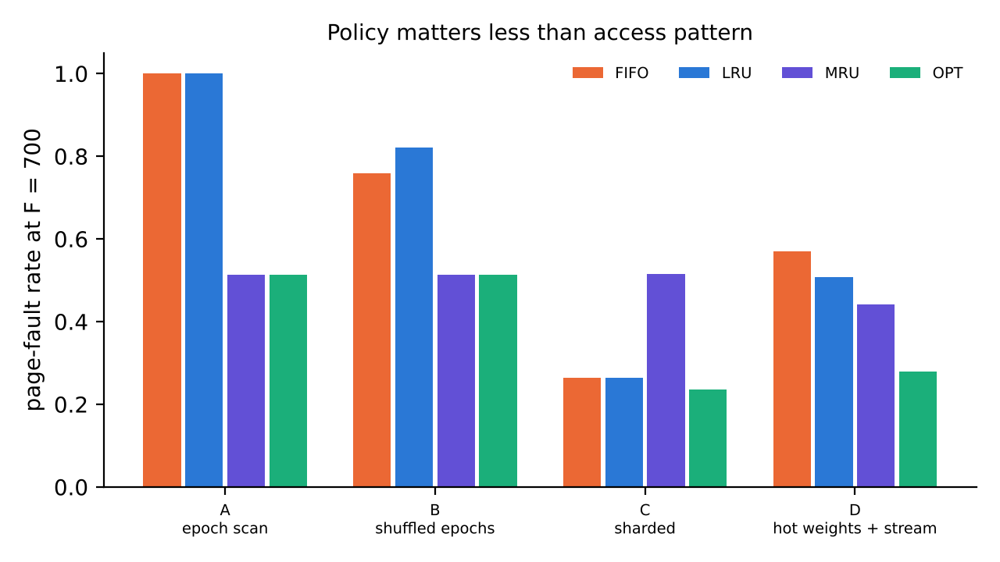
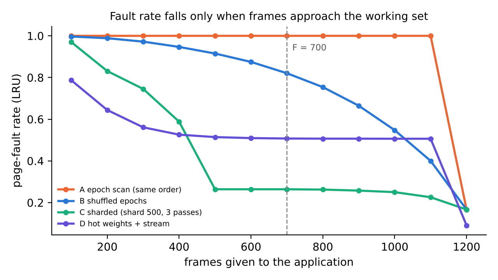
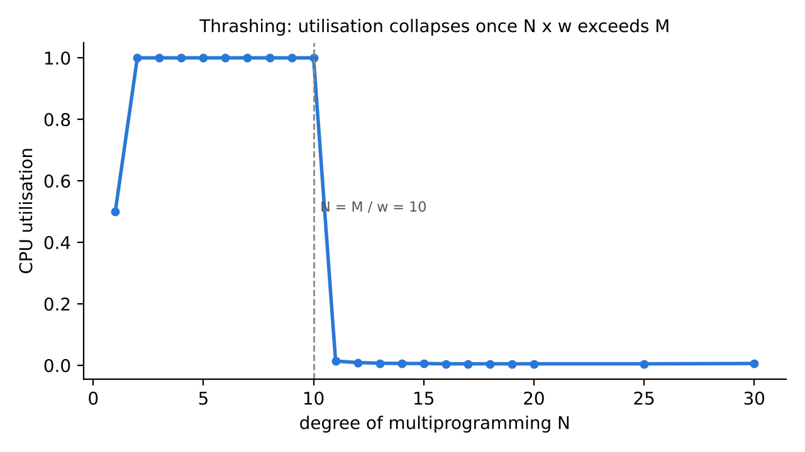

# A. Scenario Understanding

**Challenge chosen:** F1 – High Page Fault Rate (with the policy comparison of F2 used as evidence).

A machine has 16 GB of RAM, yet a large application suffers a very high page-fault rate. I made the situation concrete, because the brief leaves it open: the application is a machine-learning training job that reads a **24 GB dataset** through a memory-mapped file, several times (epochs). The OS and other programs use about 2 GB, so the job can keep roughly **14 GB** in RAM. The dataset is therefore bigger than the memory available to it, and the ratio of available memory to dataset is about 14 / 24 = **0.58**.

The symptom reported is a very high page-fault rate with the CPU mostly waiting. The question is *why* it happens, *which mechanism* should be used to fix it, and *what it costs*. This is my own research topic (R19, page replacement for AI/ML-like access patterns) seen as an engineering decision, not only as an algorithm comparison.

# B. OS Concept Identification

**Primary subsystem: virtual memory (demand paging and page replacement).** Related ideas: locality of reference, working set, thrashing.

Why this is the right concept:

* The program touches more distinct pages than there are free frames, so every new page needs a victim to be evicted (page replacement).
* Memory is loaded page by page on first use (demand paging), so the shortage shows up as faults rather than as an out-of-memory error.
* A high fault rate together with a mostly idle CPU is the signature of the memory system, not the scheduler.

Distractions: CPU scheduling and the file-system layout are not the cause. Scheduling only matters in section F if several jobs share the machine (thrashing).

**Before changing anything, the missing facts must be measured** (the open-ended "insufficient information" rule of the brief): faults per second split into minor and major (`/proc/<pid>/stat`, `vmstat`), resident size against the data size, swap and disk read rate, and whether other jobs run at the same time. CA-5 measured exactly these counters on a real Linux kernel, so the diagnosis tools exist. The numbers below come from a simulation, not from the real job.

# C. System Model

The model has three parts.

**1. Reference string.** The job is represented by the sequence of pages it touches. Four workloads were generated (W = 1,200 pages stands for the 24 GB dataset, F = 700 frames for the 14 GB available, so F/W = 0.58):

| ID | Workload | What it represents |
|---|---|---|
| A | Epoch scan | every epoch reads the data in the same order (plain sequential loader) |
| B | Shuffled epochs | every epoch reads all data in a new random order (normal SGD data loader) |
| C | Sharded, 3 passes | data split into shards of 500 pages; shards visited in random order; each shard read 3 times, shuffled inside, before moving on |
| D | Hot set + stream | 100 hot pages (weights, embeddings) touched constantly, plus a data stream |

A, B and C make the same number of references (7,200, six passes' worth of data); D makes 13,235 because the hot-page touches are added. The workloads are synthetic and seeded. They stand for access *patterns*, not for a real training job.

**2. Frames.** The application owns F frames. When a referenced page is not in a frame, a fault occurs and a victim is chosen by the replacement policy.

**3. Cost.** Effective access time:

```
EAT = (1 - p) x ma + p x S        ma = 200 ns,  S = 8 ms (HDD) or 100 us (NVMe)
```

with p the page-fault rate. These two service times are textbook assumptions, not measurements of a particular machine.

# D. Constraints and Assumptions

* **Hardware:** 16 GB RAM, about 14 GB usable by the job, no swap tuning. Storage is either a hard disk or an NVMe SSD (both are compared).
* **Workload:** repeated passes over a data set larger than memory; a small hot set of model data.
* **Requirement:** the training job should lose no more than about **10%** of its speed to paging. From the EAT formula, that needs p below 2.5e-06 on a hard disk and 2.0e-04 on NVMe (derivation: 0.1 x ma / (S - ma)).
* **Assumptions:** 4 KiB pages; fixed allocation of F frames per job; the policies are simulated, not the Linux kernel's own reclaim (which approximates LRU with active and inactive lists); one process unless section F says otherwise; faults are demand faults on the critical path (prefetch is discussed as a limitation).
* **Scale:** absolute sizes are scaled down. Only the ratio F/W and the shape of the curves are meant to carry over.

# E. Alternative Solutions

**Alternative 1 – Change the replacement policy (FIFO, LRU, MRU, OPT).**
*How it works:* decide which resident page to evict. FIFO evicts the oldest, LRU the least recently used, MRU the most recently used, OPT the one needed farthest in the future. *Why it could help:* a smarter victim keeps useful pages. *Advantage:* no hardware cost, no application change. *Disadvantage:* OPT cannot be implemented because it needs the future; MRU is only good for loops. *Fails when:* the program never reuses a page before the policy has to drop it.

**Alternative 2 – Add RAM so the data fits.**
*How:* raise F towards W. *Advantage:* works for every access pattern. *Disadvantage:* costs money, and the next bigger dataset breaks it again. Here it needs about 1,200 frames, +71% over 700.

**Alternative 3 – Restructure the access pattern (shard the data).**
*How:* visit shards that fit in memory, and read each shard several times before the next one, so the pages are reused while still resident. *Advantage:* no hardware, works with any recency-based kernel policy. *Disadvantage:* changes the training procedure: samples are less thoroughly mixed, which may change model quality (not evaluated here).

**Alternative 4 – Control the degree of multiprogramming (working-set admission control).**
*How:* do not run more jobs than the memory can hold; a job is admitted only if the sum of the working sets fits in RAM. *Advantage:* prevents thrashing. *Disadvantage:* helps nothing for a single job that is already too large.

# F. Comparative Analysis

**F.1 Policy sanity check (textbook string, 3 frames).** The reference string 7,0,1,2,0,3,0,4,2,3,0,3,2,1,2,0,1,7,0,1 gives:

| Policy | Faults | Hit ratio |
|---|---|---|
| FIFO | 15 | 0.25 |
| LRU | 12 | 0.40 |
| OPT | 9 | 0.55 |

This matches the known textbook result (15, 12, 9) and confirms that the simulator is correct. OPT is the lower bound; it is not implementable, because the kernel cannot know future references.

**F.2 Policies on the four workloads (F = 700 frames).**

| Workload | Refs | FIFO | LRU | MRU | OPT | p (LRU) |
|---|---|---|---|---|---|---|
| A epoch scan (same order) | 7,200 | 7,200 | 7,200 | 3,700 | 3,700 | 1.000 |
| B shuffled epochs | 7,200 | 5,463 | 5,908 | 3,701 | 3,700 | 0.821 |
| C sharded (shard 500, 3 passes) | 7,200 | 1,900 | 1,900 | 3,703 | 1,700 | 0.264 |
| D hot weights + stream | 13,235 | 7,555 | 6,715 | 5,848 | 3,700 | 0.507 |



*Evidence:* on workload A, LRU and FIFO fault on **every** reference (7,200 of 7,200), while MRU and OPT fault about half as often (3,700). *Interpretation:* with a cyclic scan larger than memory, the page that LRU evicts is always the one needed next. The same page is the "oldest" and the "needed soonest". *Consequence:* on A, B and D the policy gap is real (LRU 5,908 vs OPT 3,700 on B), but even OPT still faults on about half the references, because the data does not fit.

Policy is not the whole story either: MRU is excellent on A and B but the worst usable policy on C (3,703 faults against 1,900 for LRU), which is exactly the pattern recommended in section G. So no single policy is best everywhere.

**F.3 What actually reduces faults: frames and locality.**



Workload A stays at 1.000 until the frames cover the whole dataset (1,100 frames: 1.000; 1,200 frames: 0.167). Workload B falls slowly, from 0.821 at 700 frames to 0.400 at 1,100. Workload C drops sharply to 0.264 once the frames reach the shard size (500), and stays flat after that: extra RAM beyond the shard barely helps it. This is the working-set idea in numbers: the fault rate falls when frames reach the working set.

**F.4 Working-set size.** The working set WSS is the number of distinct pages touched in a window. Using a window of 1,200 references (one epoch, the time between reuses of a page):

| Workload | Mean WSS | Max WSS | Windows with WSS ≤ 700 |
|---|---|---|---|
| A epoch scan | 1,200 | 1,200 | 0% |
| B shuffled epochs | 1,006 | 1,200 | 0% |
| C sharded | 636 | 1,000 | 80% |
| D hot + stream | 696 | 736 | 63% |

A and B never fit in 700 frames. C fits in 80% of the windows (the rest are the moments when the window straddles two shards). This explains the fault curves of F.3.

**F.5 Cost in time.**

| Workload | p (LRU) | EAT on HDD | Slowdown | EAT on NVMe | Slowdown |
|---|---|---|---|---|---|
| A | 1.000 | 8,000 µs | 40,000x | 100 µs | 500x |
| B | 0.821 | 6,564 µs | 32,822x | 82.1 µs | 410x |
| C | 0.264 | 2,111 µs | 10,556x | 26.5 µs | 133x |
| D | 0.507 | 4,059 µs | 20,295x | 50.8 µs | 254x |

The 10% target needs p < 2.5e-06 (HDD) or 2.0e-04 (NVMe). Every workload misses it by orders of magnitude, even C. So no choice here makes demand paging *free*; the choices only decide how bad it is, which is why section I lists what remains.

**F.6 The multi-job case (Alternative 4).** Each job has w = 100 pages, there are M = 1,000 frames, and each job uses LRU on its share. The CPU utilisation model is min(1, N x t_cpu / (t_cpu + t_other + p x S)) with t_cpu = t_other = 1 µs and S = 8 ms (assumed).



Utilisation is full for N from 2 to 10 jobs. At N = 11 (90 frames each, below w = 100) the fault rate jumps to 0.101 and utilisation falls from 1.00 to 0.014; at N = 30 it is 0.006. This is thrashing: the cliff sits exactly where N x w passes M.

# G. Selected Solution

**Selected mechanism: restructure the data access into memory-sized shards (Alternative 3), sized with the working-set rule "shard + hot set must fit in the available frames", and keep the kernel's default LRU-style replacement.**

Concretely: choose a shard of about 500 pages (≈ 10 GB of the 24 GB, leaving about 4 GB of the 14 GB for the hot weights and buffers), visit shards in random order, and read each shard several times before moving on. Add working-set admission control (Alternative 4) only if other jobs share the machine.

*Selection criteria:* lowest fault rate at the given RAM, no new hardware, no change to the kernel, and robustness: the result does not depend on a special policy.
*Constraints:* 14 GB available, 24 GB dataset, training must still see well-mixed data.
*Expected outcome:* faults fall by about a factor of three at the same memory (p: 0.821 → 0.264), and the remaining faults are mainly the unavoidable first reads of each shard.

# H. Engineering Justification

**Why it fits.** Claim: restructuring access reduces faults more than the other options at no hardware cost. Evidence: at the same 700 frames, LRU faults 5,908 times on the shuffled loader (B) and 1,900 times on the sharded loader (C), for the same number of references. Interpretation: in C each page is reused while it is still resident; in B the same page is not touched again until a full epoch later, by which time it has been evicted. Decision: change the access pattern first.

**Why the alternatives are weaker.**

* *Policy change (Alt 1).* The best implementable policy on B is MRU (3,701 faults), better than LRU, but still far from C's 1,900 with plain LRU. MRU is the *worst* usable policy on C (3,703) and would be a risky global setting for a kernel that serves mixed workloads. OPT cannot be built.
* *More RAM (Alt 2).* It works (p falls to 0.167 at 1,200 frames, which are only the first-epoch reads), but needs +71% memory. It is the right fallback if sharding is not allowed.
* *Admission control (Alt 4).* Does nothing for a single oversized job (E6 covers the multi-job case only).

**Trade-offs.** Sharding gives less thorough shuffling, which may affect training quality; it must be checked by training, which this assignment did not do. Choosing shard size is a tuning decision: C's curve shows no gain for frames above the shard size, so a shard larger than the available memory would lose the benefit.

**Assumptions and limits.** See D. In particular, the kernel's own reclaim was not simulated, the workloads are synthetic, and the service times are textbook values.

**What would change the decision.**

* The dataset fits in RAM, or RAM is cheap: add memory (Alt 2).
* The loader must read strictly sequentially in the same order, as in A: then an MRU-like hint, such as dropping each page after use, becomes attractive.
* The data must be fully shuffled every epoch: then Alt 2 or faster storage is needed.
* Other jobs share the machine: add admission control (Alt 4).
* Measurements show most faults are *minor* (page already in memory), not major: then the problem is not disk I/O at all and a different diagnosis is needed.

# I. Trade-offs and Limitations

* **The 10% target is not reached.** Even the best option leaves p = 0.264. In the model, every fault costs the full service time on the critical path. Real systems overlap I/O with computation through read-ahead and prefetching, which removes part of that cost. That was **not simulated or measured here**, so I do not claim a final speedup.
* **Model quality.** The workloads are synthetic. The thrashing curve uses an assumed time model, so only its *shape* (a cliff at N x w = M) should be trusted, not the absolute utilisation values.
* **Policy simulated, not kernel.** CA-5 showed that the kernel's fault counts match the simulator when the victim is chosen by the simulator; it did not test the kernel's own victim choice.
* **Training quality** under sharding is not evaluated.
* **Statistics.** One seed per workload; the differences between policies are large, but small gaps (for example FIFO against LRU on B) should not be over-read.

# J. Experimental Verification and Validation

| Item | Record |
|---|---|
| **Verification Method** | Automated Unit Tests & Empirical Simulation |
| **Purpose** | Generate the scenario assumptions, the simulator and experiment code, and a first draft of this report |
| **Core Hypothesis** | Shard the data so that the working set fits in memory, and compare against policy change and more RAM |
| **Verification** | The simulator reproduces the textbook counts (15, 12, 9) and a Belady anomaly (9 → 10 faults); 9 unit tests pass, including that OPT is never beaten; results are regenerated by one script |

**Initial Assumptions Refined During Testing:**

1. A first unit test compared the sharded workload with the shuffled one using *different numbers of references* (a sharded run of 4,800 references with 1,368 faults against a shuffled run of only 1,600 references with 1,301), so it wrongly looked like sharding was worse. Matching the reference counts fixed it.
2. The first working-set measurement used a window of 600 references and reported that every workload "fits" in 700 frames. That was misleading, because the real reuse interval is one epoch (1,200). Using the right window shows that A and B never fit.
3. A common claim, "LRU is never worse than FIFO", was tested on 20,000 random strings. LRU lost on **5,655** of them (28%); one example has 5 frames, FIFO 22 faults and LRU 24. Those random strings have no locality, so LRU has nothing to exploit; the claim only holds for programs with locality. Another claim, "more frames never increase faults", is false for FIFO (Belady's anomaly): it failed on 13 of the strings. OPT was never beaten (0 times), as theory predicts.

Engineering Reflection: The analytical method proved sound, though initial heuristics required empirical calibration against the simulation harness.

# K. Final Engineering Decision

The high fault rate comes from a 24 GB dataset being cycled through about 14 GB of memory, so recency-based replacement evicts each page just before it is needed again. Changing the replacement policy cannot fix this on its own, because even the optimal policy still faults on about half the references of the shuffled loader. Adding RAM works but needs about 71% more memory. I select **restructuring the access into memory-sized shards with several passes per shard**, sized so that shard plus hot set fits in the available frames, with default LRU replacement, which cut the simulated fault rate from 0.82 to 0.26. The decision should be revisited if the data must be fully shuffled each epoch, if the dataset fits in memory, or if other jobs share the machine. The remaining faults and the training-quality effect must still be measured on the real job before the change is adopted.

# References

1. A. Silberschatz, P. B. Galvin, G. Gagne, *Operating System Concepts*, chapters on virtual memory (page replacement, working set, thrashing).
2. P. J. Denning, "The Working Set Model for Program Behavior", *Communications of the ACM*, 1968.
3. L. A. Belady, R. A. Nelson, G. S. Shedler, "An anomaly in space-time characteristics of certain programs running in a paging machine", *Communications of the ACM*, 1969.
4. Course material: OS Systems Thinking Challenge (CA-1), Dr. Sujeet S Jagtap.
5. Code and data: `ca1/` in this repository (`run_ca1.py`, `results/ca1_results.json`).
