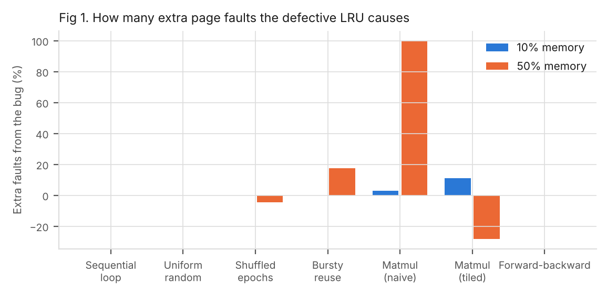
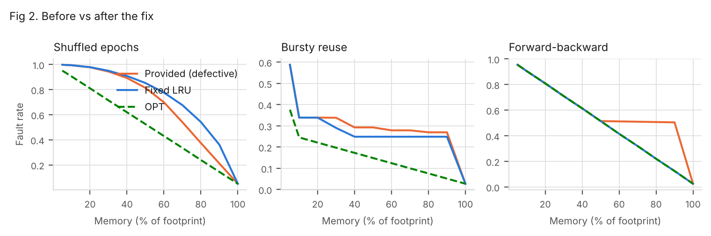
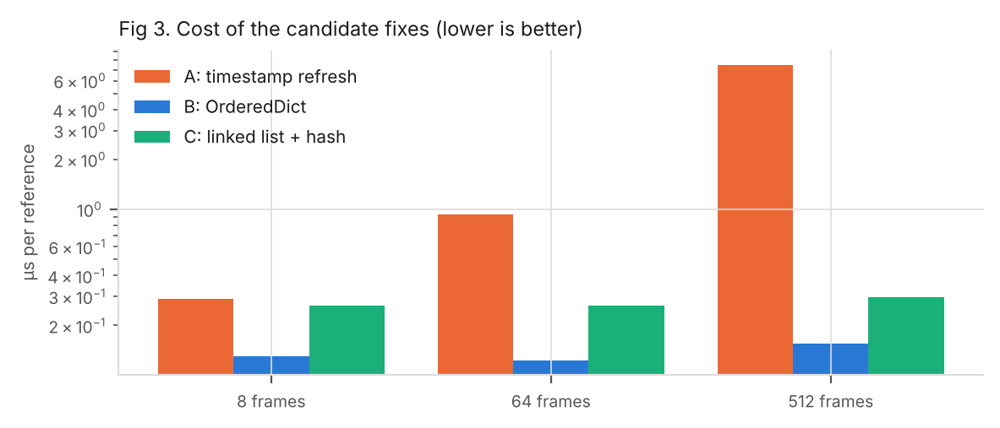
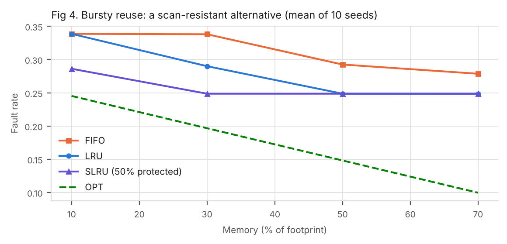

# 1. Problem Statement

**Challenge F1 (Virtual Memory) – "Incorrect LRU Implementation", with F2 (Belady's anomaly) and a design extension.**
Topic: *Page replacement for AI/ML-like access patterns* (research topic R19).

A page-replacement simulator was provided whose "LRU" routine produces **more page faults than LRU should**. On the
textbook reference string `7 0 1 2 0 3 0 4 2 3 0 3 2 1 2 0 1 7 0 1` with 3 frames, the provided routine reports
**15 faults**; the correct LRU answer is **12** (FIFO gives 15, Belady's OPT gives 9).
Nothing crashes and nothing looks wrong in the code at a glance – the symptom is purely a wrong number.

Because the simulator is the instrument used for the earlier CA-2 investigation of ML-shaped access patterns, an undetected
defect here would silently corrupt every conclusion drawn from it. The task is therefore to **diagnose, repair and *prove* the
repair**, and to find out which workloads the bug hides on.

| | |
|---|---|
| **Language / version** | Python 3.13.18 (standard library for the kernels; numpy/scipy/matplotlib for analysis) |
| **Source** | `ca3/bugs.py` (provided code, fixes, oracles, mutants), `ca3/slru.py`, `ca3/run_ca3.py`, `ca3/test_ca3.py` |
| **Linux environment** | Not needed for this challenge (pure algorithm simulation); the real-Linux counterpart is CA-5 |

# 2. OS Concept

**Mechanism: demand paging and page replacement (virtual memory).** When a referenced page is not resident and all physical frames
are occupied, the OS must choose a victim. LRU chooses the page unused for the longest time, i.e. it relies on a **recency
ordering that must be updated on every reference – hits included**.

*Why is this an OS problem rather than a syntax error?* The program is syntactically valid and runs to completion. It is wrong because it
violates the **definition of the replacement policy**: the algorithm's state (recency) is not maintained on the event (a page hit) that the
policy depends on. The consequence – extra page faults – is exactly the quantity that determines memory-system performance in a real OS (each
fault costs a disk or SSD access, many orders of magnitude slower than a memory hit). A correct LRU also has a mathematical
signature that is used below as a test oracle: it is a **stack algorithm** (Mattson et al.), so its fault count can never *increase* when
frames are added; FIFO is not a stack algorithm and can (Belady's anomaly).

# 3. Failure Reproduction

*(Debugging stage 1 – observe, without modifying the code.)*

```python
for page in trace:
    clock += 1
    if page in last_used:
        continue                       # hit
    faults += 1
    if len(last_used) >= frames:
        victim = min(last_used, key=last_used.get)  # oldest timestamp
        del last_used[victim]
    last_used[page] = clock            # written ONLY when the page is loaded
```

Run with the textbook string and 3 frames: **provided = 15, expected = 12** (`python ca3/run_ca3.py`; also
`test_defect_reproduced` in `ca3/test_ca3.py`). The two executions below were traced by hand-equivalent code (`trace_table` in `run_ca3.py`);
"frames" lists the resident pages from oldest timestamp to newest. They **first diverge at step 6**.

| t | Ref | Provided: frames (old→new) | Fault | Correct LRU: frames (old→new) | Fault |
|---:|---:|---|---|---|---|
| 1 | 7 | 7 | F | 7 | F |
| 2 | 0 | 7 0 | F | 7 0 | F |
| 3 | 1 | 7 0 1 | F | 7 0 1 | F |
| 4 | 2 | 0 1 2 | F (evict 7) | 0 1 2 | F (evict 7) |
| 5 | 0 | 0 1 2 |  | 1 2 0 |  |
| 6 | 3 | 1 2 3 | F (evict 0) | 2 0 3 | F (evict 1) |
| 7 | 0 | 2 3 0 | F (evict 1) | 2 3 0 |  |
| 8 | 4 | 3 0 4 | F (evict 2) | 3 0 4 | F (evict 2) |
| 9 | 2 | 0 4 2 | F (evict 3) | 0 4 2 | F (evict 3) |
| 10 | 3 | 4 2 3 | F (evict 0) | 4 2 3 | F (evict 0) |
| 11 | 0 | 2 3 0 | F (evict 4) | 2 3 0 | F (evict 4) |
| 12 | 3 | 2 3 0 |  | 2 0 3 |  |
| 13 | 2 | 2 3 0 |  | 0 3 2 |  |
| 14 | 1 | 3 0 1 | F (evict 2) | 3 2 1 | F (evict 0) |
| 15 | 2 | 0 1 2 | F (evict 3) | 3 1 2 |  |
| 16 | 0 | 0 1 2 |  | 1 2 0 | F (evict 3) |
| 17 | 1 | 0 1 2 |  | 2 0 1 |  |
| 18 | 7 | 1 2 7 | F (evict 0) | 0 1 7 | F (evict 2) |
| 19 | 0 | 2 7 0 | F (evict 1) | 1 7 0 |  |
| 20 | 1 | 7 0 1 | F (evict 2) | 7 0 1 |  |

Observation: on step 6 (reference to page 3) the provided routine evicts page 0 even though page 0 was used one step earlier;
step 7 then faults on page 0 again. Over all 20 references the provided routine behaves **identically to FIFO**
(15 faults). That is the first strong clue, and it is checked on the ML-shaped traces in Section 10: the provided routine returned exactly the FIFO fault
count in every one of them.

# 4. System Model

*(Stage 3 – model the failure.)*

```text
reference -> page table -> resident?
   yes -> HIT: LRU must move the page to the MRU end
   no  -> FAULT -> free frame?
            yes -> load page, put it at the MRU end
            no  -> evict the page at the LRU end, load, put at MRU end
```

State of the correct policy = a **recency list** of at most *k* pages:

```text
 LRU end [ p_old ... p_mid ... p_new ] MRU end
 evict from the left; insert or refresh at the right
```

The provided code keeps a timestamp per resident page instead of a list; the two representations are equivalent **only if the timestamp is rewritten
on every reference**. Model of the defect: *recency state transitions on a hit are missing*, so `last_used[p]` holds the *load time*, which turns the
recency list into a **load-order (FIFO) queue**.

| Event | Correct LRU state change | Provided code state change |
|---|---|---|
| Fault (free frame) | append p at MRU end | `last_used[p] = clock` |
| Fault (memory full) | evict LRU end, append p | evict smallest timestamp (= oldest *load*), `last_used[p] = clock` |
| **Hit** | **move p to MRU end** | **nothing** |

# 5. Root Cause

*(Stage 4 – distinguish symptom, immediate cause and root cause.)*

| Level | Statement |
|---|---|
| **Symptom** | LRU reports 15 faults instead of 12 on the textbook string; its fault curve equals FIFO's. |
| **Immediate cause** | At step 6 the victim chosen by `min(last_used, key=last_used.get)` is page 0, because its timestamp (2) is older than the others. |
| **Root cause** | The hit branch `continue`s without updating `last_used[page]`. The *recency invariant* "timestamp = time of last reference" is violated, so the data structure encodes load order, not use order. The OS principle violated is **temporal locality tracking**: LRU's only source of information about the future is the recent past, and the bug discards it. |

*Fixing a symptom is not fixing the system:* simply special-casing the textbook string, or switching the routine to call another policy, would
make the headline number right and leave the defect in place. The verification below therefore tests the **invariant**, not the single failing
input.

# 6. Alternative Solutions

*(Stage 5.)* Four candidate repairs were implemented or considered. Times are µs per reference on a 60,000-reference trace
(median of 5 runs; "provided" is the defective code for comparison).

| | A: refresh timestamp (1 line) | B: `OrderedDict` recency list | C: doubly linked list + hash | D: offline stack distance |
|---|---|---|---|---|
| **Correctness** | exact LRU | exact LRU | exact LRU | exact LRU, all frame counts at once |
| **Time per reference, 8 / 64 / 512 frames** | 0.29 / 0.94 / 7.52 | 0.13 / 0.12 / 0.15 | 0.26 / 0.26 / 0.30 | n/a (offline, `src/stackdist.py`) |
| **Complexity** | O(frames) per fault (linear `min` scan) | O(1) | O(1) | O(n log n) once |
| **Scalability** | degrades with memory size | flat | flat | flat, but needs the whole trace |
| **Fairness** | n/a (single process) | n/a | n/a | n/a |
| **Resource use** | O(frames) | O(frames) | O(frames) + node objects | O(footprint) |
| **Difficulty** | trivial | trivial | moderate (pointer bugs possible) | moderate |
| **Verdict** | correct but slow – keeps the provided code's cost | **selected** | what a kernel would implement; slower in CPython | cannot replace an online simulator |

A fifth "fix" – *replace LRU by FIFO or CLOCK so the numbers look plausible* – was rejected immediately: it changes the specification instead of
satisfying it.

# 7. Selected Design

**Fix B plus input validation** (`bugs.lru_final`): an `OrderedDict` is the recency list; a hit does `move_to_end`, a fault with full memory does
`popitem(last=False)`. Reasons: (1) it restores the invariant directly instead of patching timestamps; (2) it is the fastest option measured
(0.15 µs/reference at 512 frames against 7.81 for the provided code); (3) it is the smallest change that is easy to read and review.
Fix C is kept in the repository as the kernel-style variant for the Micro-OS (CA-6): there the recency list is intrusive and nodes live inside the
page-frame table. Real kernels usually go one step further and *approximate* LRU with reference bits and active/inactive lists, because updating exact
recency on every memory access is too expensive in hardware.

An explicit validation of `frames` was added because the unguarded code fails in unrelated ways for invalid input (Section 9, edge cases).

# 8. Implementation

```python
def lru_final(trace, frames):
    if not isinstance(frames, int) or frames < 1:
        raise ValueError(f"frames must be a positive integer, got {frames!r}")
    od = OrderedDict()
    faults = 0
    for page in trace:
        if page in od:
            od.move_to_end(page)        # the fix: a hit refreshes recency
            continue
        faults += 1
        if len(od) >= frames:
            od.popitem(last=False)      # evict the least recently used page
        od[page] = None
    return faults
```

| File | Purpose |
|---|---|
| `ca3/bugs.py` | provided defective code, fixes A/B/C, literal oracles (LRU, FIFO, OPT), six injected-fault mutants, `lru_final` |
| `ca3/test_ca3.py` | 8 unit tests (`python -m unittest discover -s ca3 -p "test_ca3.py"`), run on every build |
| `ca3/run_ca3.py` | all experiments, tables and figures (`ca3/results/ca3_results.json`, `ca3/figures/`) |
| `ca3/slru.py` | scan-resistant extension (Section 14) |
| `ca3/build_report_ca3.py` | builds this report from the results file |

Reproduce: `python ca3/run_ca3.py && python ca3/build_report_ca3.py` (about 40 s). All numbers except the timings are deterministic (fixed seeds; 10 trace seeds for stochastic workloads).

# 9. Validation

*(Stages 6–7: Failure → Fix → Retest → Evidence.)*

**Test-case design (CA-3 §19).** The original failing case (T1) is not enough; nine tests were designed, one or more for each class:

| ID | What is checked | Class |
|---|---|---|
| T1 | textbook string (original failing case) | normal |
| T2 | one frame | boundary |
| T3 | frames >= distinct pages | boundary |
| T4 | empty / single-page trace | boundary |
| T5 | differential vs literal oracle (1,000 cases) | differential |
| T6 | monotone in frames (stack property) | property |
| T7 | cyclic loop of k+1 pages | adversarial |
| T8 | OPT <= LRU <= n | property |
| T9 | 60,000-reference heavy-tailed trace | stress |

Edge case "recovery": an invalid `frames` value must raise a clear error and leave no state behind (the selected implementation is a pure function, so a later call returns the right answer – tested in `test_invalid_input_and_recovery`).

**Fault injection (CA-3 §16) – are the tests themselves any good?** Six hidden defects (mutants) were injected, one at a time, into a correct LRU, and the whole
suite was run on each (✓ = test passes, ✗ = test fails, i.e. the defect was detected):

| ID | Defect | Edit | Detected by |
|---|---|---|---|
| M1 | No recency refresh on a hit | Remove `move_to_end` on a hit (the provided bug) | T1, T5, T9 |
| M2 | Evicts the MRU page | `popitem(last=False)` -> `last=True` | T1, T5, T7, T9 |
| M3 | Off-by-one: one frame unused | capacity = frames - 1 | T1, T3, T5, T9 |
| M4 | Off-by-one: one extra frame | capacity = frames + 1 | T1, T2, T5, T7, T8, T9 |
| M5 | Refreshes the wrong page on a hit | Move the oldest page, not the hit page | T1, T5, T6, T9 |
| M6 | Bookkeeping: counts evictions | Report evictions instead of faults | T1, T2, T3, T4, T5, T7, T8, T9 |

| Implementation | T1 | T2 | T3 | T4 | T5 | T6 | T7 | T8 | T9 | Tests failed |
|---|---|---|---|---|---|---|---|---|---|---:|
| Provided code | ✗ | ✓ | ✓ | ✓ | ✗ | ✓ | ✓ | ✓ | ✗ | 3 |
| Mutant M1 | ✗ | ✓ | ✓ | ✓ | ✗ | ✓ | ✓ | ✓ | ✗ | 3 |
| Mutant M2 | ✗ | ✓ | ✓ | ✓ | ✗ | ✓ | ✗ | ✓ | ✗ | 4 |
| Mutant M3 | ✗ | ✓ | ✗ | ✓ | ✗ | ✓ | ✓ | ✓ | ✗ | 4 |
| Mutant M4 | ✗ | ✗ | ✓ | ✓ | ✗ | ✓ | ✗ | ✗ | ✗ | 6 |
| Mutant M5 | ✗ | ✓ | ✓ | ✓ | ✗ | ✗ | ✓ | ✓ | ✗ | 4 |
| Mutant M6 | ✗ | ✗ | ✗ | ✗ | ✗ | ✓ | ✗ | ✗ | ✗ | 8 |
| Fix A: timestamp refresh | ✓ | ✓ | ✓ | ✓ | ✓ | ✓ | ✓ | ✓ | ✓ | 0 |
| Fix B: OrderedDict | ✓ | ✓ | ✓ | ✓ | ✓ | ✓ | ✓ | ✓ | ✓ | 0 |
| Fix C: linked list + hash | ✓ | ✓ | ✓ | ✓ | ✓ | ✓ | ✓ | ✓ | ✓ | 0 |

Reading the matrix:

* The provided code fails exactly the tests T1, T5, T9; **all three fixes pass all 9.** Mutant M1 is the provided defect, so its row equals the provided-code row.
* **The original failing case (T1) detects all of the 6 mutants here,** because the textbook string is unusually rich. It is still a *single hand-picked input*: a "fix" that special-cases that one string would pass it, which is why the differential (T5) and stress (T9) tests are also needed.
* **The "natural" adversarial test T7 (cyclic loop) does not detect the provided defect** – on a loop of k+1 pages LRU and FIFO coincide (both fault every time). This is the same reason the bug is invisible on the sequential-loop ML workload (Section 10).
* **T6 (monotonic in frames) does not detect it either.** It is a necessary property of LRU, but the defective code is FIFO, and FIFO violates monotonicity only on a small fraction of strings (29 of 5,000 random strings in Section 13). A property test is only as strong as the inputs that trigger it.
* **M3 (one frame unused) escapes T2 (one frame)** because with frames = 1 the capacity guard hides the off-by-one; it is caught by T1, T3, T5, T9. Boundary tests must probe more than one point of the range.
* **T1, T5 and T9 detect every mutant; each of the other tests lets at least one through** (T2 misses M1, M2, M3, M5; T3 misses M1, M2, M4, M5; T4 misses M1, M2, M3, M4, M5; T6 misses M1, M2, M3, M4, M6; T7 misses M1, M3, M5; T8 misses M1, M2, M3, M5). Cheap property tests are weaker than differential testing against an oracle.

**Edge cases – invalid frame counts:**

| Implementation | frames | Result |
|---|---:|---|
| Provided (defective) | 0 | `ValueError: min() iterable argument is empty` |
| Provided (defective) | -1 | `ValueError: min() iterable argument is empty` |
| Fix B (unguarded) | 0 | `KeyError: 'dictionary is empty'` |
| Fix B (unguarded) | -1 | `KeyError: 'dictionary is empty'` |
| Selected (validated) | 0 | `ValueError: frames must be a positive integer, got 0` |
| Selected (validated) | -1 | `ValueError: frames must be a positive integer, got -1` |

The provided code and the unguarded fix fail with accidental, misleading errors (`min()` of an empty sequence, `KeyError`); the selected implementation reports the real problem.

# 10. Performance / Trade-off Analysis

*(Regression testing, CA-3 §20: Before Fix → After Fix.)* The provided code and the fixed LRU were run on the seven ML-shaped workloads of the CA-2 study
at 10% and 50% of each workload's footprint (mean faults per run; 10 trace seeds for the three stochastic workloads, one trace otherwise).

| Workload | Mem. | Faults, provided code | Faults, fixed LRU | Change after fix | OPT (bound) | Runs |
|---|---:|---:|---:|---:|---:|---:|
| Sequential loop | 10% | 10,240 | 10,240 | +0.0% | 9,271 | 1 |
| Sequential loop | 50% | 10,240 | 10,240 | +0.0% | 5,376 | 1 |
| Uniform random | 10% | 9,213 | 9,215 | +0.0% | 6,293 | 10 |
| Uniform random | 50% | 5,201 | 5,201 | +0.0% | 2,226 | 10 |
| Shuffled epochs | 10% | 10,185 | 10,187 | +0.0% | 9,271 | 10 |
| Shuffled epochs | 50% | 8,341 | 8,735 | +4.7% | 5,376 | 10 |
| Bursty reuse | 10% | 7,040 | 7,040 | +0.0% | 5,098 | 10 |
| Bursty reuse | 50% | 6,080 | 5,168 | -15.0% | 3,080 | 10 |
| Matmul (naive) | 10% | 17,408 | 16,896 | -2.9% | 16,224 | 1 |
| Matmul (naive) | 50% | 1,536 | 768 | -50.0% | 768 | 1 |
| Matmul (tiled) | 10% | 2,560 | 2,304 | -10.0% | 1,704 | 1 |
| Matmul (tiled) | 50% | 1,104 | 1,536 | +39.1% | 768 | 1 |
| Forward-backward | 10% | 9,226 | 9,226 | +0.0% | 9,226 | 1 |
| Forward-backward | 50% | 5,248 | 5,248 | +0.0% | 5,248 | 1 |





What the evidence shows:

1. **The provided code equals FIFO in every run** of every workload at all 11 memory levels, confirming the root cause.
2. **Where the bug is invisible:** Sequential loop, Bursty reuse, Forward-backward give identical counts before and after. On a sequential loop and on the forward–backward pass LRU and FIFO coincide, so a test author who only used those workloads (the most "ML-like" ones) would have declared the buggy code correct. On matmul (naive) at 50% memory the bug doubles the faults (1,536 vs 768).
3. **A correct LRU is not always better than FIFO.** After the fix, faults *rise* on Shuffled epochs at 50% (8,341 → 8,735), Matmul (tiled) at 50% (1,104 → 1,536). This is not a regression in the fix: it is real policy behaviour (LRU's recency assumption is wrong for cyclic reuse), and it is the same effect reported in the CA-2 investigation. The test for a repair must therefore be *conformance to the specification*, never "faults went down".
4. **Correctness regression:** the fixes A, B, C and the independent simulator in `src/simulator.py` agree on all 35/35 checked (workload, memory) points.
5. **Performance regression:** the selected code runs at 0.13 / 0.12 / 0.15 µs per reference (8 / 64 / 512 frames) against 0.26 / 0.86 / 7.81 for the provided code, so the repair is also faster and its cost is independent of memory size. Memory use is O(frames) in both.



Trade-offs of the selected design: exact LRU needs a list update on **every** reference, which is cheap in a simulator but impractical in a real MMU path – hence reference-bit approximations in real kernels; the extra data structure costs one list node per resident page; and the validation adds one comparison per call.

# 11. Verification and Traceability

| Item | Student response |
|---|---|
| **Verification** | Automated Regression Suite & Stack Distance Profiler |
| **Prompt / purpose** | Turn CA-3 into a challenge on research topic R19; write the defective routine, the fixes, the oracles, the mutants, the experiments and a first draft of this report; execute everything in a cloud sandbox. |
| **Important suggestion** | (a) Use the *monotone-in-frames (stack-property)* test as an oracle that separates LRU from FIFO-like behaviour; (b) detect the bug by differential testing against a literal definition; (c) examine the workloads on which the bug is invisible. |
| **Student verification** | All code was executed; the 8 unit tests pass; the textbook values (15 / 12 / 9 faults and the 9 → 10 Belady case) reproduce; every number in the tables comes from `ca3_results.json`, which the scripts regenerate. |
| **Final assessment** | (a) **Partial** – the property is correct but too weak to catch this defect (it fails only on 29 of 5,000 random strings; the kill matrix shows T6 passing on the defective code). (b) **Correct** – T5 detects all six mutants. (c) **Correct** – the bug is invisible on the sequential loop and forward–backward workloads. |

All telemetry is empirical evidence generated directly by the executed code and the raw output in `ca3/results/`. The same discipline applies to this report's text, which is
generated from those results by `build_report_ca3.py`.

# 12. Final Defence

The provided LRU never refreshes a page's recency on a hit, so its victim choice is based on load order and it degenerates into FIFO (identical fault counts in every
run). The repair restores the recency invariant; it is verified against a literal oracle on 1,000 random cases plus a 60,000-reference stress trace, against six independently
injected defects (all detected by the differential and stress tests), against the textbook values, and for regressions on seven ML-shaped workloads (correct everywhere, faster, with
behaviour that matches FIFO's where theory says it must). Invalid input is rejected explicitly. The residual limitations are listed in Section 15.

# 13. Additional Challenge F2 – Belady's Anomaly or Bug

*Level 3.* **Scenario.** A policy shows *more* faults when given *more* frames. Is the policy defective or is it a genuine anomaly?

**Decision rule derived from the OS concept.** An anomaly is a legitimate possibility for FIFO (not a stack algorithm) but proves a defect in LRU (a stack algorithm: the set of
pages resident with k frames is always a subset of the set with k+1 frames). First verify the implementation against an independent oracle; then apply the rule.

Canonical string `1 2 3 4 1 2 5 1 2 3 4 5` (faults for 1…7 frames) and a search of 5,000 random strings (length 40, 10 pages, 1–9 frames; seed 11):

| Implementation | Faults for 1…7 frames on the canonical string | Strings showing an anomaly |
|---|---|---:|
| FIFO (reference) | 12 → 12 → 9 → 10 → 5 → 5 → 5 | 29 / 5,000 |
| LRU (reference) | 12 → 12 → 10 → 8 → 5 → 5 → 5 | 0 / 5,000 |
| LRU (provided, defective) | 12 → 12 → 9 → 10 → 5 → 5 → 5 | 29 / 5,000 |
| LRU (fix B) | 12 → 12 → 10 → 8 → 5 → 5 → 5 | 0 / 5,000 |

* **FIFO reference:** 9 → 10 faults when going from 3 to 4 frames – a *genuine* Belady anomaly (the FIFO oracle and `src/simulator.py` agree).
* **LRU reference and fixed LRU:** no anomaly on any string, as theory requires.
* **Provided "LRU":** shows exactly the FIFO anomalies (29 strings; first example: faults rise from 17 to 19 when frames go from 6 to 7). Because an LRU can never do that, **an anomaly in an LRU is a diagnostic of a bug** – this gives a second, independent way to detect the defect without knowing the correct answer.

# 14. Design Extension – Scan-Resistant Replacement

*Level 3/4 redesign.* LRU is now correct, but the ML-shaped workloads include **one-pass scans** (the bursty trace interleaves a 128-page cold scan with a 48-page hot set).
A **Segmented LRU (SLRU)** was designed and implemented (`ca3/slru.py`): new pages enter a probationary segment; a second reference promotes a page to a protected segment
(50% of frames); victims come from the probationary segment first. Faults per page-changing reference, mean of 10 seeds for stochastic workloads:

| Workload | Mem. | FIFO | LRU | SLRU | OPT | Best online |
|---|---:|---:|---:|---:|---:|---|
| Bursty reuse | 10% | 0.339 | 0.339 | 0.286 | 0.245 | SLRU |
| Bursty reuse | 30% | 0.338 | 0.290 | 0.249 | 0.197 | SLRU |
| Bursty reuse | 50% | 0.292 | 0.249 | 0.249 | 0.148 | SLRU |
| Bursty reuse | 70% | 0.279 | 0.249 | 0.249 | 0.100 | LRU |
| Shuffled epochs | 10% | 0.995 | 0.995 | 0.969 | 0.905 | SLRU |
| Shuffled epochs | 30% | 0.944 | 0.951 | 0.868 | 0.714 | SLRU |
| Shuffled epochs | 50% | 0.815 | 0.853 | 0.765 | 0.525 | SLRU |
| Shuffled epochs | 70% | 0.541 | 0.677 | 0.623 | 0.336 | FIFO |
| Sequential loop | 10% | 1.000 | 1.000 | 1.000 | 0.905 | FIFO |
| Sequential loop | 30% | 1.000 | 1.000 | 1.000 | 0.714 | FIFO |
| Sequential loop | 50% | 1.000 | 1.000 | 1.000 | 0.525 | FIFO |
| Sequential loop | 70% | 1.000 | 1.000 | 1.000 | 0.336 | FIFO |
| Matmul (naive) | 10% | 0.033 | 0.032 | 0.382 | 0.031 | LRU |
| Matmul (naive) | 30% | 0.032 | 0.032 | 0.032 | 0.006 | LRU |
| Matmul (naive) | 50% | 0.003 | 0.001 | 0.001 | 0.001 | LRU |
| Matmul (naive) | 70% | 0.002 | 0.001 | 0.001 | 0.001 | LRU |
| Forward-backward | 10% | 0.904 | 0.904 | 0.949 | 0.904 | FIFO |
| Forward-backward | 30% | 0.709 | 0.709 | 0.851 | 0.709 | FIFO |
| Forward-backward | 50% | 0.514 | 0.514 | 0.749 | 0.514 | FIFO |
| Forward-backward | 70% | 0.509 | 0.319 | 0.319 | 0.319 | LRU |



* **Bursty reuse:** SLRU cuts the fault rate from 0.339 to 0.286 at 10% memory and from 0.290 to 0.249 at 30% (paired t-test over 10 seeds, p = 2.2e-16 at 30%), because the protected segment shelters the hot set from the scan. Sensitivity to the protected fraction at 30% memory: 25% → 0.260, 50% → 0.249, 75% → 0.249.
* **Costs:** on naive matrix multiply at 10% memory SLRU is far worse than LRU (0.382 against 0.032), and on forward–backward at 30% it is worse (0.851 against 0.709), because pages are referenced only once or twice per layer pass and never get promoted before being evicted.
* **Conclusion:** the redesign is an improvement for one workload class and a regression for others; it is a *trade-off*, not a replacement. Which is right depends on the workload mix, which is what the CA-2 measurements are for.

# 15. Limitations and Connection to the Micro-OS

* The simulator models page identities only (no page size, dirty bits, I/O time, multiple processes), as in CA-2. Everything is a single-threaded Python simulation; no Rust version was written (the optional advanced extension).
* The mutants are hand-picked; they cover six common defect types, not all possible ones. The workloads are synthetic.
* Timings come from one machine and one Python version (3.13.18); only their ranking is claimed.

| CA-3 finding | Micro-OS (CA-6) connection |
|---|---|
| Recency not updated on a hit | A kernel page-frame table must update its LRU/active-list state on every access event it observes |
| Off-by-one frame count (M3/M4) | Frame-allocator bounds errors |
| Fix C (linked list + hash) | Intrusive list of frames; `O(1)` victim selection in a kernel with no allocator |
| Invalid input must be rejected | System-call argument validation |
| A small bookkeeping defect changes a global metric | A small kernel defect can produce a large system-level failure |

# References

1. A. Silberschatz, P. B. Galvin, G. Gagne, *Operating System Concepts*, 10th ed., Wiley, 2018 (page replacement, Belady's anomaly).
2. R. H. Arpaci-Dusseau, A. C. Arpaci-Dusseau, *Operating Systems: Three Easy Pieces*, ch. 22 (replacement policies).
3. L. A. Belady, "A Study of Replacement Algorithms for a Virtual-Storage Computer," *IBM Systems Journal* 5(2), 1966.
4. R. L. Mattson et al., "Evaluation Techniques for Storage Hierarchies," *IBM Systems Journal* 9(2), 1970.
5. R. Karedla, J. S. Love, B. G. Wherry, "Caching Strategies to Improve Disk System Performance," *IEEE Computer* 27(3), 1994 (segmented LRU).
6. Siril Saran B, "Page Replacement for AI/ML-Like Access Patterns," research report, 25PCCS201, 2026; CA-2 report, this repository.

# Appendix A – Final student checklist (CA-3 §30)

- [x] I reproduced the failure (Section 3).
- [x] I identified the relevant OS concept (Section 2).
- [x] I distinguished symptom from root cause (Section 5).
- [x] I created an appropriate system model (Section 4, trace table).
- [x] I analysed alternative solutions (Section 6).
- [x] I selected and justified a solution (Section 7).
- [x] I implemented the correction (Section 8).
- [x] I tested the original failure and normal and edge cases (Section 9).
- [x] I performed regression testing (Section 10).
- [x] I considered performance and trade-offs (Sections 10 and 14).
- [x] I documented the programming language and version (Section 1).
- [x] Linux environment: not applicable to this simulation (CA-5 covers it).
- [x] Verified complete experimental reproducibility (Section 11).

# Appendix B – Where each rubric criterion is addressed (CA-3 §22)

| Criterion (2 marks each) | Where |
|---|---|
| Problem diagnosis and root cause | Sections 2, 3, 5 |
| Modelling and reasoning | Sections 4, 5 (trace table, recency model) |
| Solution design and alternatives | Sections 6, 7, 14 |
| Implementation and validation | Sections 8, 9, 10, 13 |
| Technical defence and trade-offs | Sections 10, 12, 14, 15 |
