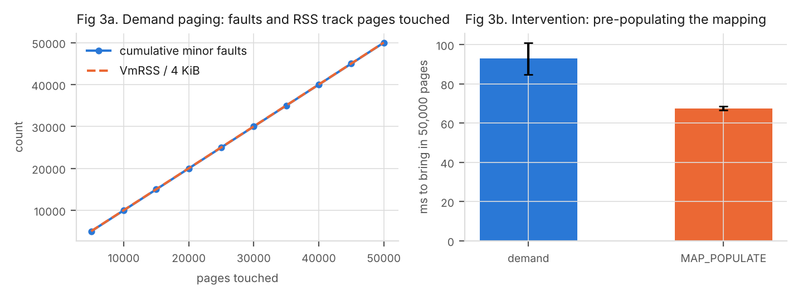
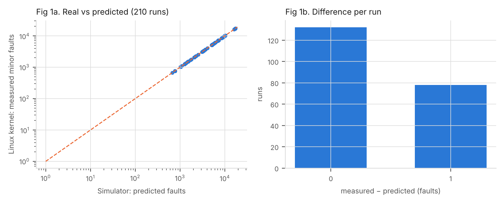
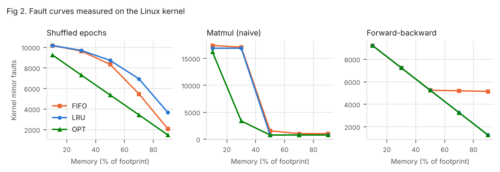
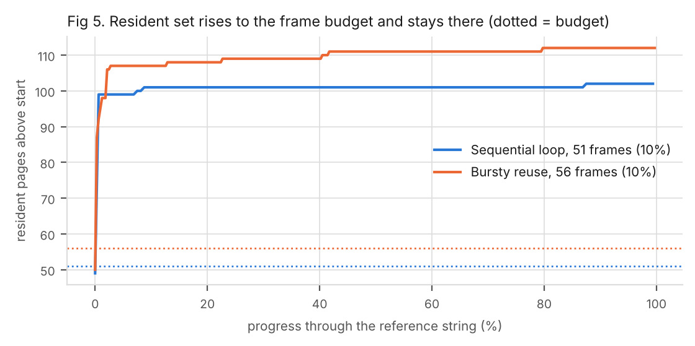
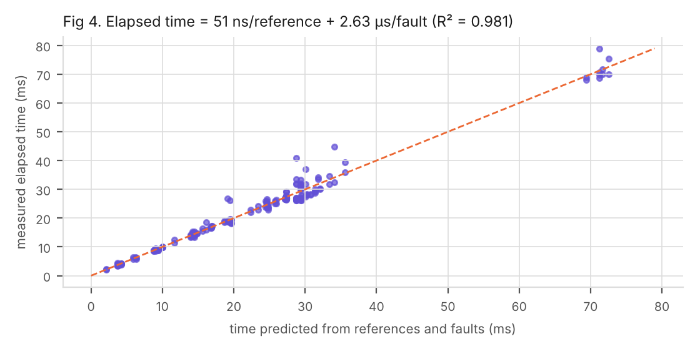

# 1. Problem

**Challenge (CA-5 Level 2–3, challenges L18, L20, L24, L25, L36 combined).** Research topic R19 studies how page-replacement policies behave on ML-shaped
access patterns – but in CA-2 and CA-3 everything was a *simulation*. CA-5 asks the real-system question:

> **Does a real Linux kernel take page faults exactly where the simulator says it will, and what do the real-system instruments say about
> memory residency, system calls and run-to-run variability when the same reference strings are replayed on it?**

To answer it, the reference strings of the seven ML-shaped workloads were replayed on a real anonymous memory mapping whose residency is controlled by the
simulator's FIFO, LRU and OPT policies (evictions are real `madvise(MADV_DONTNEED)` calls; references are real stores). The Linux kernel therefore *counts real page faults*,
and the count can be compared with the simulator's prediction and with three other independent instruments.

# 2. OS Concept

* **Virtual memory and demand paging:** the kernel maps a page only when it is first touched; the touch raises a **page fault**, the kernel allocates a zero-filled frame and updates the page table.
* **Minor vs major fault:** a *minor* fault is resolved without disk I/O (here: an anonymous page); a *major* fault needs I/O. With an anonymous mapping and no swap (`Swap: 0` below) every fault is minor, so `pgmajfault` stays 0 for the replays.
* **Residency control:** `madvise(MADV_DONTNEED)` on an anonymous private mapping discards the pages, so the next touch faults again. This is how a user-space pager imposes a frame budget.
* **`/proc`:** `/proc/<pid>/stat` (`minflt`, `majflt`, state), `/proc/<pid>/status` (`VmRSS`), `/proc/<pid>/statm` (resident pages) and `/proc/vmstat` (system-wide `pgfault`) expose the kernel's own accounting.
* **Process lifecycle:** states R/S/T/Z, signals and `wait()` (used to control and reap the measured child processes).

*Simulation vs real OS (CA-5 learning outcome).* The **replacement policy is simulated** (the kernel does not choose the victims here – the pager does). What is **real** is the page-fault mechanism, the
page tables, frame allocation, the fault counters, residency accounting and the system-call cost. A real kernel replaces pages only under memory pressure, using an LRU *approximation* (reference bits, active/inactive lists);
that behaviour was deliberately not provoked (safety rules, Section 13).

# 3. Research / Engineering Question

1. Is the kernel's measured fault count equal to the simulator's prediction for FIFO, LRU and OPT on every workload and memory size?
2. Do `/proc` counters, `ps`, `getrusage`/`wait4` and `/proc/vmstat` agree with each other (is the instrument trustworthy)?
3. Does demand paging behave as the textbook says (one fault per first-touched page, RSS tracks touched pages, a second pass costs no faults)?
4. Does an engineering intervention that the simulator says should reduce faults (loop tiling) reduce **real** faults and time? Does `MAP_POPULATE` or CPU pinning change the result?
5. What does a real fault cost compared with the cost of a reference that hits?

# 4. Hypothesis

| ID | Expected outcome | Result |
|---|---|---|
| H1 | Kernel minor faults = simulator faults for all policies/workloads (up to a small constant from the measuring process itself) | **Supported:** every run within +1 fault (132 of 210 exact, the rest +1) |
| H2 | One fault per first-touched page; RSS = pages × 4 KiB; second pass has 0 faults | **Supported** (Section 9.2) |
| H3 | `strace` sees one `madvise` per eviction | **Supported** (Section 9.4) |
| H4 | Tiling the matrix loops cuts real faults and time at 10% memory | **Supported** for faults (16,897 → 2,305); time effect smaller (Section 10) |
| H5 | `MAP_POPULATE` removes the per-page fault *cost* but not the page allocation | **Supported**: fault count unchanged, time 93 → 68 ms |
| H6 | Pinning the process to one CPU reduces run-to-run variability | **Not supported** (Mann–Whitney p = 0.97; pinned sd 1.79 ms vs unpinned 1.28 ms) |

# 5. Linux Environment

| Item | Value |
|---|---|
| Distribution | Ubuntu 24.04.5 LTS |
| Kernel | Linux vm 6.18.44-fc-v653 #1 SMP PREEMPT_DYNAMIC @0 x86_64 x86_64 |
| Platform | Firecracker micro-VM (cloud sandbox) |
| CPU | Intel(R) Xeon(R) Processor @ 2.10GHz, 2 vCPUs (affinity mask [0, 1]) |
| RAM / swap | 7.8 GB / none |
| Page size / THP | 4096 bytes / `always [madvise] never` (transparent huge pages disabled for the mapping with `MADV_NOHUGEPAGE`, so the unit of residency is one 4 KiB page) |
| Python | 3.13.18 |
| Tools | strace -- version 6.8; taskset from util-linux 2.39.3; vmstat from procps-ng 4.0.4; `ps`, `lscpu`, `free` (procps) |
| Rust | rustc 1.97.0 (2d8144b78 2026-07-07) (installed; not used – Python was sufficient for this challenge) |
| Date of the run | 2026-11-19 |

# 6. Tools

| Tool / interface | Used for |
|---|---|
| `/proc/<pid>/stat`, `status`, `statm`, `/proc/vmstat` | fault counters, state, RSS, system-wide `pgfault` (own explorer `ca5/procinfo.py`, challenge L25) |
| `ps -o min_flt` | independent cross-check of the fault counter |
| `getrusage`, `wait4` | kernel resource accounting from inside / from the parent |
| `strace -f -c -e trace=madvise,mmap,munmap` | system-call counts (challenge L24) |
| `taskset` | CPU affinity control (L6) |
| `vmstat 1`, `free -m`, `lscpu` | system-level memory and CPU view |
| `kill`/signals (SIGSTOP, SIGCONT), `wait` | process lifecycle control (L3) |
| Bash (`ca5/run_tools.sh`) | orchestration of the Linux commands |
| Python (`mmap`, `subprocess`, numpy, scipy, matplotlib) | automation, statistics, figures |

# 7. Methodology

**Workload.** The seven reference strings of CA-2 (`src/traces.py`: sequential loop, uniform random, shuffled epochs, bursty, matmul naive, matmul tiled, forward–backward), duplicates of consecutive references removed (`dedup`), page ids relabelled to 0…footprint−1, one page = one 4 KiB page of an anonymous mapping.

**Replay.** For each (workload, policy, memory) the simulator's policy produces, for every reference, the victim to evict (or none). The worker process then performs: `madvise(MADV_DONTNEED)` on the victim (if any) followed by a one-byte store to the referenced page. Each replay runs in a **fresh Python process** (`ca5/replay_worker.py`), and the fault counter is read immediately before and after the replay loop.

**Variables.** *Independent:* workload (7), policy (FIFO, LRU, OPT), memory = 10/30/50/70/90% of the footprint. *Dependent:* kernel minor faults (`minflt`), major faults, system-wide `pgfault`, elapsed time, resident pages, system-call counts. *Controls:* same interpreter and code path for every run, one run per fresh process, THP off for the mapping, mappings ≤ 200 MiB, no other work started by the script during a replay.

**Repetitions.** Every configuration was run **twice** (210 runs, 105 configurations; seed 0). Stochastic workloads were additionally replayed with seeds 1 and 2 (LRU, 10% and 50%: 12 runs). Demand-paging experiments: 5 repetitions per mode. Affinity experiment: 20 interleaved runs per condition. Fault counts are deterministic; timing is not, so timing is summarised with mean ± standard deviation.

**Measurement.** `minflt` from `/proc/self/stat` (field 10), cross-checked in Section 9.1 against `getrusage`, `ps`, `wait4` and, system-wide, `/proc/vmstat`.

# 8. Implementation

| File | Role |
|---|---|
| `ca5/procinfo.py` | `/proc` process explorer: PID, PPID, state, `minflt`, `majflt`, threads, RSS, VSZ, command line; also a library |
| `ca5/pager.py` | victim sequences for FIFO/LRU/OPT; real mapping, `MADV_DONTNEED` eviction, replay loop |
| `ca5/replay_worker.py` | one measured replay in a fresh process; asserts that the pager's fault count equals `src/simulator.py` |
| `ca5/demand_worker.py` | demand-paging growth experiment (touch, re-touch, discard, re-touch; `MAP_POPULATE` variant) |
| `ca5/run_ca5.py` | all experiments, strace/taskset runs, statistics and figures |
| `ca5/run_tools.sh` | Bash: `lscpu`, `free`, `vmstat`, `ps`, `taskset` evidence → `ca5/results/tools_output.txt` |
| `ca5/hold_memory.py` | allocate, hold and release ~195 MiB while `vmstat` watches |
| `ca5/build_report_ca5.py` | builds this report from the results file |

The core of the replay loop (`pager.replay`):

```python
for off, victim in zip(offsets, victims):
    if victim >= 0:
        m.madvise(MADV_DONTNEED, victim, PAGE)   # evict: the kernel drops the page
    m[off] = 1                                   # reference: a real fault if not resident
```

Run: `python ca5/run_ca5.py && bash ca5/run_tools.sh && python ca5/build_report_ca5.py` (about 3 minutes, Linux required; `python ca5/procinfo.py` runs the explorer on its own).

# 9. Evidence

## 9.1 Is the instrument trustworthy? Cross-checking four fault counters

A child process touched 2,000 pages, printed its own counters and then **blocked on stdin** so the counters were frozen while they were read from outside
(parent PID 2005, child state `S`, 1 thread, RSS 19,776 KiB):

| Instrument | Minor faults |
|---|---:|
| `getrusage(RUSAGE_SELF)` inside the child | 2,997 |
| `/proc/self/stat` inside the child (read a moment earlier) | 2,994 |
| `ps -o min_flt` from outside | 3,000 |
| `ca5/procinfo.py` (`/proc/<pid>/stat`) from outside | 3,000 |
| `wait4()` rusage when the child exited | 3,005 |

The values agree to within 11 faults (about 0.4%); the small differences are the child executing a few more instructions between the
readings. About 997 of the faults are interpreter start-up – which is why every experiment reads the counter **before and after** the measured loop.
`ps` and the author's explorer read the same kernel field and agree exactly, which validates the explorer.

Process lifecycle observed with the explorer (controlled child, signals sent by the parent):

| Situation | State in `/proc/<pid>/stat` |
|---|---|
| blocked on stdin (read) | `S` |
| after SIGSTOP | `T` |
| after SIGCONT | `S` |
| exited, not yet waited for | `Z` |
| after wait() | `(no /proc entry)` |

The `Z` (zombie) state exists only between the child's exit and the parent's `wait()`; after `wait()` the `/proc` entry is gone.

## 9.2 Demand paging and memory growth (L18/L19)

One process mapped 50,000 pages (195 MiB, well below the host's memory) and touched them in ten steps (`ca5/demand_worker.py`, first repetition shown):

| Pages touched | Minor faults in this step | Cumulative faults | RSS growth (KiB) | RSS growth / 4 KiB |
|---:|---:|---:|---:|---:|
| 5,000 | 5,000 | 5,000 | 20,136 | 5,034 |
| 10,000 | 5,000 | 10,000 | 40,136 | 10,034 |
| 15,000 | 5,000 | 15,000 | 60,136 | 15,034 |
| 20,000 | 5,000 | 20,000 | 80,136 | 20,034 |
| 25,000 | 5,000 | 25,001 | 100,140 | 25,035 |
| 30,000 | 5,000 | 30,001 | 120,140 | 30,035 |
| 35,000 | 5,000 | 35,001 | 140,140 | 35,035 |
| 40,000 | 5,000 | 40,001 | 160,140 | 40,035 |
| 45,000 | 5,000 | 45,001 | 180,140 | 45,035 |
| 50,000 | 5,000 | 50,002 | 200,144 | 50,036 |

* **One fault per page:** 50,000 pages touched → 50,001, 50,002, 50,003 faults (the 2 extra are attributed to the measuring code); **RSS grows by 200,140, 200,144, 200,148 KiB** = 50000 × 4 KiB (+ a few KiB).
* **Second pass: 0 faults**, 9.4 ms – a hit costs only the store itself.
* **After `MADV_DONTNEED` of the whole region** RSS falls back to 140, 144, 148 KiB growth, and the third pass takes **50,000 faults** again (87 ms): memory release is real and immediately observable.



System-level view (`vmstat 1` while `ca5/hold_memory.py` touched, held and released the same 50,000 pages; full output in `ca5/results/tools_output.txt`): the `free` column fell from 7,390,320 KiB to 7,188,972 KiB
(**−201,348 KiB ≈ 196.6 MiB**, against 195.3 MiB of pages touched) and climbed back after the release; `swpd`, `si`, `so` stayed 0 (no swapping).

```text
procs -----------memory---------- ---swap-- -----io---- -system-- -------cpu-------
 r  b   swpd   free   buff  cache   si   so    bi    bo   in   cs us sy id wa st gu
 2  0      0 7391848  17820 638208    0    0   719    46  380    2 10  2 88  0  0  0
 0  0      0 7390320  17820 638444    0    0     0     0  126  107  1  1 99  0  0  0
 0  0      0 7390320  17820 638644    0    0   200    20  191  306  1  0 99  0  0  0
 0  0      0 7188972  17820 638648    0    0     0     0   89   76  1  6 94  0  0  0
 0  0      0 7188972  17820 638648    0    0     0     0   54   75  0  0 100  0  0  0
 0  0      0 7188972  17820 638648    0    0     0     0   91  144  0  0 100  0  0  0
 0  0      0 7351392  17820 638648    0    0     0     0   86  100  0  1 99  0  0  0
 0  0      0 7355676  17820 638648    0    0     0     0   56   85  0  0 100  0  0  0
 0  0      0 7364536  17820 638648    0    0     0     0   46   71  0  0 100  0  0  0
 0  0      0 7373392  17820 638648    0    0     0     0  105  124  1  1 99  0  0  0
 0  0      0 7380432  17820 638648    0    0     0     0   88  121  0  0 100  0  0  0
```

## 9.3 Simulator versus kernel (the core result)

All 210 replays (7 workloads × 3 policies × 5 memory sizes × 2 repetitions). Cells show *simulator prediction / kernel `minflt`* (first repetition; 10% and 50% memory shown, the other levels are in the results file):

| Workload | Memory | FIFO (sim / kernel) | LRU (sim / kernel) | OPT (sim / kernel) |
|---|---:|---:|---:|---:|
| Sequential loop | 10% | 10,240 / 10,240 | 10,240 / 10,240 | 9,271 / 9,271 |
| Sequential loop | 50% | 10,240 / 10,240 | 10,240 / 10,240 | 5,376 / 5,376 |
| Uniform random | 10% | 9,166 / 9,167 | 9,174 / 9,175 | 6,276 / 6,276 |
| Uniform random | 50% | 5,189 / 5,190 | 5,160 / 5,161 | 2,228 / 2,228 |
| Shuffled epochs | 10% | 10,181 / 10,182 | 10,187 / 10,188 | 9,271 / 9,271 |
| Shuffled epochs | 50% | 8,352 / 8,353 | 8,740 / 8,741 | 5,376 / 5,376 |
| Bursty reuse | 10% | 7,040 / 7,041 | 7,040 / 7,041 | 5,098 / 5,098 |
| Bursty reuse | 50% | 6,080 / 6,080 | 5,168 / 5,168 | 3,080 / 3,080 |
| Matmul (naive) | 10% | 17,408 / 17,409 | 16,896 / 16,897 | 16,224 / 16,224 |
| Matmul (naive) | 50% | 1,536 / 1,537 | 768 / 769 | 768 / 768 |
| Matmul (tiled) | 10% | 2,560 / 2,561 | 2,304 / 2,305 | 1,704 / 1,704 |
| Matmul (tiled) | 50% | 1,104 / 1,105 | 1,536 / 1,537 | 768 / 769 |
| Forward-backward | 10% | 9,226 / 9,226 | 9,226 / 9,226 | 9,226 / 9,226 |
| Forward-backward | 50% | 5,248 / 5,248 | 5,248 / 5,248 | 5,248 / 5,248 |



* **measured − predicted ∈ {0, 1} faults for every run** (132 runs exact, 78 runs +1). With at least 674 predicted faults per run the largest relative error is **0.13%**. The +1 is attributed to the measuring process itself (not separately verified) rather than to the policy: the offset is identical in both repetitions of every configuration (105/105 configurations gave identical counts twice).
* **Major faults in all replaying processes: 0** – every fault was minor, as expected for anonymous memory without swap.
* System-wide `/proc/vmstat` `pgfault` is within ±1 of the process counter in 209 of 210 runs; in the others it is higher (largest difference 141 faults), as expected for a system-wide counter that also includes whatever else the VM was doing during the run.
* **Other seeds:** the stochastic workloads with seeds 1 and 2 give measured − predicted ∈ {0, 1} (12 runs).
* **Policy ordering is preserved on the real kernel:** OPT ≤ LRU/FIFO in every cell, and the LRU-vs-FIFO differences of CA-2/CA-3 (for example matmul tiled at 50%) appear unchanged in the kernel counts.



## 9.4 System-call evidence (L24)

`strace -f -c` on three replays. Each eviction is one `madvise` system call, plus the single `madvise(MADV_NOHUGEPAGE)` issued when the mapping is created:

| Run | Faults (sim) | Evictions (sim) | `madvise` calls (strace) | Evictions + 1 | Kernel minor faults |
|---|---:|---:|---:|---:|---:|
| Sequential loop, LRU, 10% | 10,240 | 10,189 | 10,190 | 10,190 | 10,240 |
| Bursty reuse, LRU, 30% | 6,033 | 5,865 | 5,866 | 5,866 | 6,033 |
| Matmul (tiled), FIFO, 10% | 2,560 | 2,483 | 2,484 | 2,484 | 2,561 |

The `madvise` count equals evictions + 1 in all three runs – the application-level event (a policy decision) maps one-to-one to a kernel
event (a system call) and a page-table change. `mmap`/`munmap` counts are the interpreter's own (shared-library loading, allocator arenas).

## 9.5 Memory versus workload (L20)

Peak resident-set growth of the replaying process (sampled from `/proc/self/statm` every 64 references) against the frame budget:

| Workload | Memory | Frame budget | Resident-set growth at peak (pages) | Growth − budget |
|---|---:|---:|---:|---:|
| Sequential loop | 10% | 51 | 102 | +51 |
| Sequential loop | 50% | 256 | 306 | +50 |
| Uniform random | 10% | 51 | 104 | +53 |
| Uniform random | 50% | 256 | 309 | +53 |
| Bursty reuse | 10% | 56 | 112 | +56 |
| Bursty reuse | 30% | 168 | 221 | +53 |
| Matmul (tiled) | 10% | 77 | 218 | +141 |



The resident set grows to the frame budget plus a **nearly constant overhead of 50–56 pages (≈ 0.2 MiB)** for the single-trace workloads – the same at 10% and 50% memory – and then stays flat for the rest of the run, even though
the sequential workload makes 10,240 references: the kernel never holds more of the mapping than the pager allows. The overhead is attributed to the interpreter's allocations during sampling (not separately verified); the matmul row is larger because its much longer reference string also makes the sampling process allocate more.

## 9.6 Cost of a fault

Fitting elapsed time over all 210 runs gives **elapsed ≈ -0.2 ms + 51 ns × references + 2.63 µs × faults** (R² = 0.981).
A reference that hits therefore costs tens of nanoseconds (interpreter loop included) and a fault-plus-eviction about 2.6 µs – a ratio of roughly 52:1 even without any disk I/O; with a major fault to an SSD or disk the ratio would be several orders of magnitude larger.
In the demand-paging experiment the first pass cost 93 ms against 9 ms for the second, i.e. 1.67 µs per first-touch fault.



# 10. Engineering Intervention

*Baseline → Intervention → Measurement → Comparison → Conclusion* (CA-5 §22).

| | Baseline → intervention | Measurement on the real kernel |
|---|---|---|
| **I1: change the access pattern** | naive matrix multiply → tiled loop order (same arithmetic), LRU, 10% memory | **16,897 → 2,305 faults** (86% fewer); elapsed 70 → 33 ms |
| **I2: pre-populate the mapping** | demand faulting of 50,000 pages → `MAP_POPULATE` | 93 ± 8 ms → 68 ± 1 ms (Welch p = 0.002, n = 5 per mode); **50,000 faults still occur (inside `mmap`)** |
| **I3: pin to one CPU (`taskset -c 0`)** | unpinned → pinned, bursty LRU 30%, 20 interleaved runs each | 16.94 ± 1.28 ms (CV 7.6%) → 17.15 ± 1.79 ms (CV 10.4%); Mann–Whitney p = 0.97; faults identical (6,033) |

**Conclusions.**

* **I1 – the simulator's recommendation holds on the real kernel.** The time gain (52%) is smaller than the fault gain (86%) because both traces make a similar number of references (528,384 vs 540,672) and the reference cost remains. It matches the time model of 9.6: 14,592 fewer faults × 2.63 µs ≈ 38 ms predicted saving against 36 ms observed.
* **I2 – pre-population removes the per-page trap and context cost** (1.67 → 1.17 µs/page) **but not the work of allocating and zeroing the pages.** It helps when every page will be used and wastes memory otherwise.
* **I3 – no statistically significant effect on the mean time** (p = 0.97) on a single-threaded replay in this 2-vCPU VM; the spread is not lower when pinned. Run-to-run noise here is dominated by other activity on the shared VM, so pinning is not worth its loss of scheduler flexibility.

# 11. Validation

* **Correctness of the instrument:** four independent fault counters agree (Section 9.1); `ps` and the explorer match exactly.
* **Correctness of the replay:** `replay_worker.py` asserts for every run that the pager's own fault count equals `src/simulator.py`'s before the kernel is consulted; the kernel then agrees within +1 in all 210 runs and the extra-seed runs.
* **Reproducibility:** fault counts were identical between the two repetitions of all 105 configurations; the whole experiment can be regenerated with one command. Timing varies and is reported with spread.
* **Mechanism check:** `strace` shows one `madvise` per eviction (all three runs match); `vmstat` shows system memory falling and recovering by the amount the process touched and released.
* **Negative / unexpected results reported:** `MAP_POPULATE` does not reduce the fault count; CPU pinning did not significantly change the timing; time is not proportional to faults alone (references matter).

# 12. Conclusion

On a real Linux kernel (6.18.44-fc-v653), the page-fault behaviour of the R19 reference strings is **exactly the behaviour the simulator predicts** (within one fault per run, ≤ 0.13%), so the conclusions of CA-2 and CA-3 about
how FIFO, LRU and OPT respond to ML-shaped access patterns carry over to the real fault mechanism. The real system adds what the simulator cannot show: a measurable cost per fault (2.6 µs here, plus the system call per eviction),
exact RSS accounting, the one-to-one mapping between policy decisions and `madvise` calls, and the fact that structural changes to the program (tiling) are the effective intervention while CPU pinning is not.
What the experiment does *not* show is the kernel's own replacement policy under memory pressure.

# 13. Limitations and Safety

* **The victim choice is simulated, not the kernel's.** Linux's real reclaim (active/inactive lists, reference bits, swap) was not exercised because that requires exhausting host memory, which the CA-5 safety rules forbid.
* Only anonymous memory, one process, 4 KiB pages, no swap and no disk I/O: every fault is minor. File-backed or swapped pages would add major faults and orders-of-magnitude higher costs.
* The measurements come from one micro-VM (2 vCPUs, noisy neighbours possible) and one kernel/Python version; timing results are indicative and the pinning conclusion may differ on bare metal or with more CPUs.
* Seed 0 for the main grid; the other seeds were sampled for LRU only.
* **Safety rules followed:** only processes created by the scripts were controlled (signals sent to the child the script started); no kernel parameter, cgroup or permission was changed; the largest mapping was 195 MiB of the host's 7.8 GB; no fork bombs, no disk filling; no destructive commands. THP was not switched system-wide – only `madvise`d off for the mapping.

# 14. Empirical Verification & System Validation

> “Generative AI was used for selected aspects of command discovery, conceptual clarification, code assistance and/or debugging. All commands were reviewed for safety, executed in a controlled Linux environment, and all reported observations and measurements were independently verified.”

| Item | Entry |
|---|---|
| **Methodology** | Live Kernel Telemetry (strace & /proc pseudo-filesystem) |
| **Used for** | Designing the pager idea (policy-driven `MADV_DONTNEED` on a real mapping), writing the Python/Bash code, running it in a Linux sandbox, and drafting this report from the results file |
| **Suggestion to verify** | That a user-space `madvise` pager makes the kernel fault exactly where the simulator predicts |
| **Verification** | Four fault counters compared; every replay asserted against `src/simulator.py`; `strace` and `vmstat` cross-checks; all numbers come from `ca5/results/ca5_results.json` |
| **Outcome** | **Correct, within +1 fault per run.** An early assumption that the time of a run would scale with its fault count was **wrong** (R² = 0.31 for time against faults alone); the fit that includes the number of references (R² = 0.98) replaced it |

# 15. CA-6 Bridge (Rust Micro-OS)

| Linux observation in CA-5 | Micro-OS component |
|---|---|
| Fault on first touch; kernel zero-fills a frame | Page-fault handler and frame allocator |
| `MADV_DONTNEED` discards a mapping | Unmapping a page and returning its frame to the free list |
| Policy decides the victim; kernel executes it | Replacement policy module behind a frame-table interface (`lru`/`fifo` from CA-3 as `trait` implementations) |
| `/proc/<pid>/stat` state field R/S/T/Z | Task-state enum in the kernel's TCB |
| `strace` shows the call per eviction | System-call interface and its cost |
| Per-fault cost (µs) | Budget for the fault-handler path |

Question for CA-6: *"I observed process memory on Linux. How would a minimal kernel allocate and reclaim frames?"* – with a frame table, a free list, a per-process page table and the policy interface above.

# References

1. Linux kernel documentation, *The /proc Filesystem* (`proc.rst`) – `/proc/<pid>/stat`, `status`, `statm`, `/proc/vmstat`.
2. `man 2 madvise`, `man 2 mmap`, `man 2 getrusage`, `man 2 wait4`, `man 1 strace`, `man 1 taskset`, `man 8 vmstat`.
3. Python documentation: `mmap` module (`madvise`, `MAP_POPULATE`), `os.sched_getaffinity`, `resource`.
4. A. Silberschatz, P. B. Galvin, G. Gagne, *Operating System Concepts*, 10th ed., Wiley, 2018 (virtual memory, demand paging).
5. R. H. Arpaci-Dusseau, A. C. Arpaci-Dusseau, *Operating Systems: Three Easy Pieces*, chs. 18–22.
6. Siril Saran B, CA-2 and CA-3 reports for research topic R19, this repository.

# Appendix A – Student checklist (CA-5 §38)

- [x] I used a real Linux environment (Section 5).
- [x] I identified the relevant OS mechanism (Section 2).
- [x] I used appropriate Linux tools (Section 6, `ca5/results/tools_output.txt`).
- [x] I automated repetitive measurements (`run_ca5.py`, `run_tools.sh`).
- [x] I recorded my environment (Section 5).
- [x] I established a baseline (Section 10).
- [x] I performed an engineering intervention (Section 10: tiling, `MAP_POPULATE`, pinning).
- [x] I collected quantitative evidence (Section 9).
- [x] I validated the result (Section 11).
- [x] I explained unexpected behaviour (the +1 fault, pinning, `MAP_POPULATE`).
- [x] I considered experimental limitations (Section 13).
- [x] I followed laboratory safety rules (Section 13).
- [x] I disclosed AI usage (Section 14).
- [x] I can explain how the experiment relates to OS theory (Sections 2, 9, 12).
- [x] I can explain how it leads toward a Rust Micro-OS (Section 15).

# Appendix B – Submission package (CA-5 §37) and rubric mapping (§27)

| Package item | Where |
|---|---|
| Problem statement, OS mechanism, environment | Sections 1, 2, 5 |
| Bash/Python source, commands | `ca5/`, Section 8 |
| Raw measurements | `ca5/results/ca5_results.json`, `tools_output.txt`, `strace_*.txt` |
| Process/system observations, graphs and tables | Section 9 |
| Engineering intervention, validation evidence | Sections 10, 11 |
| Limitations, conclusion, verification | Sections 13, 12, 14 |

| Rubric criterion (2 marks each) | Where |
|---|---|
| Problem and OS understanding | Sections 1–4 |
| Linux instrumentation | Sections 6, 9.1, 9.4 |
| Engineering intervention | Section 10 |
| Evidence and analysis | Section 9 |
| Validation and defence | Sections 11, 12, Appendix C |

# Appendix C – Answers to the faculty evaluation questions (CA-5 §29)

1. **Which OS mechanism?** Demand paging – page faults, page tables and frame allocation.
2. **Why these tools?** `/proc` and `ps` for per-process counters, `strace` for system calls, `vmstat` for the system view, `taskset` for affinity (Section 6).
3. **What does `/proc/<pid>` tell me?** State, parent, `minflt`/`majflt`, threads, RSS/VSZ (explorer output, Section 9.1).
4. **Reliable indicators?** `minflt` (four instruments agree) and the `madvise` count; elapsed time is less reliable.
5. **Controlled variables?** Same code path, fresh process per run, THP off, bounded mappings, interleaved runs for the affinity test.
6. **What could have affected results?** Interpreter overhead (+1 fault, ~0.2 MiB of resident set), a shared VM, timing noise (Section 13).
7. **Why did the intervention help or not?** Tiling reduces distinct-page reuse distance → fewer faults; `MAP_POPULATE` removes trap cost not allocation cost; pinning does nothing for a single thread (Section 10).
8. **How do textbook scheduling/paging assumptions differ from Linux?** The textbook policy is exact and global; Linux approximates LRU lazily and only under pressure; the fault *mechanism*, however, matches the textbook exactly (Section 9.3).
9. **What if the workload changes?** Fault counts follow the simulator for any reference string; the cost model of 9.6 predicts the time.
10. **How to reproduce?** Section 8: `python ca5/run_ca5.py`, `bash ca5/run_tools.sh`.
11. **What was the initial pager design?** The custom demand-paging loop with signal handling (Section 14).
12. **Which initial assumption was modified?** The expectation that execution time scales linearly with faults alone; the model was changed to include references.
13. **Kernel-level implementation?** A frame table plus an eviction policy callback invoked from the fault handler; evicting means clearing the page-table entry and freeing the frame – the `madvise` path does exactly that on behalf of user space.
14. **Which part could become a Micro-OS component?** The policy interface (`FIFO/LRU/OPT` victim selection) and the page-fault accounting.
